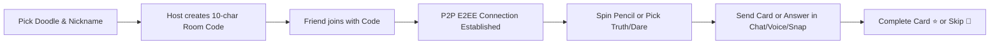

# 📒 Doodle Truth or Dare — 2-Player Secret Notebook

> A cozy, hand-drawn sketch-style web app for two friends to play Truth or Dare in real time — featuring private peer-to-peer WebRTC networking, end-to-end encryption (E2EE), live voice chat, custom prompt decks, and instant polaroid snap sharing.

[](https://samaed-samee.github.io/truth-or-dare/)
[](LICENSE)

👉 **Live Web App**: [https://samaed-samee.github.io/truth-or-dare/](https://samaed-samee.github.io/truth-or-dare/)

---

## ✨ Overview

**Doodle Truth or Dare** transforms the classic party game into an intimate, interactive sketchbook designed specifically for two players. Built with a hand-drawn notebook aesthetic, warm color palette, and bouncy micro-animations, the entire app runs directly in the browser as a standalone, serverless application with zero backend requirements.

All communications—including chat messages, truth/dare cards, and photos—flow directly between peers over **WebRTC** and are safeguarded with **AES-GCM 256-bit End-to-End Encryption**.

---

## 🚀 Key Features

### 🎨 Hand-Drawn Notebook Aesthetic
- **Sketched Paper Theme**: Ruled lines, graph paper textures, washi tape accents, and wobbly hand-drawn borders.
- **Custom Typography**: Powered by Google Fonts ([`Caveat`](https://fonts.google.com/specimen/Caveat), [`Fredoka`](https://fonts.google.com/specimen/Fredoka), and [`Patrick Hand`](https://fonts.google.com/specimen/Patrick+Hand)).
- **8 Custom Doodle Avatars**: Hand-crafted inline SVG avatars that render consistently without emoji font clipping:
  - 🦊 Fox • 🐼 Panda • 🐸 Frog • 🐱 Cat • 🐰 Bunny • 🦁 Lion • 🐨 Koala • 🐙 Octopus

### 🔒 Zero-Server Peer-to-Peer & E2EE Privacy
- **Direct P2P Connectivity**: Built using [PeerJS](https://peerjs.com/) and WebRTC DataChannels + MediaStreams.
- **End-to-End Encrypted (Web Crypto API)**:
  - ECDH (Elliptic Curve Diffie-Hellman P-256) key exchange handshake.
  - PBKDF2 / HKDF room-key derivation.
  - AES-GCM 256-bit authenticated encryption for every message, card, and image chunk.
- **Privacy-First**: No database, no chat storage on third-party servers, and no account registration needed.

### 🎙️ Real-Time Live Voice Chat
- **One-Tap Voice Calls**: Toggle microphone on or off at any moment.
- **Audio Processing**: WebRTC native echo cancellation, noise suppression, and automatic gain control.
- **Live Status Badges**: Visual pulsing ring and partner mic indicator (`Live 🎙️` / `Off 🔇`).

### 🃏 Interactive Truth or Dare Gameplay
- **Turn-Based Flow**: Dynamic turn indicator and live scoreboard (`⭐ Stars`).
- **✏️ Spin the Pencil**: Interactive turn randomizer with live animation and synchronized outcomes.
- **Custom Prompt Builder**: Write custom truths or dares on the fly for your partner.
- **Prompt Deck Manager**:
  - Pre-loaded with fun, friendly starter prompts.
  - Add your own custom prompts saved to local storage and synced automatically between players.
  - Filter deck by *All*, *Truths*, or *Dares*, and play any card with one tap.
- **Card Actions**: Real-time flip animations, card skipping, and completion tracking (+1 Star).

### 📷 Polaroid Instant Snaps
- **Client-Side Image Compression**: Automatic canvas downscaling (max 850px) and JPEG compression to keep WebRTC transfers fast.
- **Chunked Data Transfer**: Large image payloads are split into 24KB chunks and reassembled safely on the receiver side.
- **Polaroid Photo Cards**: Displays photos in a tilted polaroid frame with timestamp and sender note.
- **Fullscreen Lightbox**: Tap any photo to view full resolution.

### 📱 Mobile Keyboard & Viewport Resilience
- **Visual Viewport Locking**: Powered by the `window.visualViewport` API and dynamic CSS variables (`--vvh`, `--vv-top`).
- **No Header Shifting**: The top header, partner presence, mic controls, and room code never scroll out of view when the mobile keyboard pops up.
- **Smart Auto-Collapse**: Automatically hides the card stage while typing so the chat stream and input stay fully accessible.

### 🔄 Auto-Reconnection & Session Recovery
- **Room Limit Enforcement**: Strict 2-player capacity based on unique player session tokens.
- **Background & Tab Switching**: Seamless auto-reconnect when switching apps or un-minimizing the browser on iOS/Android.
- **Session Restoration**: Persists game state and recent chat history to `sessionStorage`.

---

## 🛠️ Technology Stack

| Technology | Usage |
| :--- | :--- |
| **HTML5 & CSS3** | Semantic structure, CSS variables, and custom notebook keyframe animations |
| **Vanilla JavaScript (ES6+)** | Game engine, state management, and real-time networking |
| **Tailwind CSS (CDN)** | Layout utilities and responsive grid helpers |
| **PeerJS (WebRTC)** | P2P data channels and live audio streaming |
| **Web Crypto API (`crypto.subtle`)** | ECDH P-256 key exchange and AES-GCM 256-bit encryption |
| **HTML5 Canvas** | Client-side photo resizing and JPEG compression |
| **Google Fonts** | `Caveat`, `Fredoka`, and `Patrick Hand` |

---

## 📦 Getting Started

### 🌐 Play Directly in Browser (No Setup Needed!)
You can jump straight into the game with a friend on mobile or desktop:
👉 **[https://samaed-samee.github.io/truth-or-dare/](https://samaed-samee.github.io/truth-or-dare/)**

### Prerequisites
All you need is a modern web browser that supports WebRTC and Web Crypto (Chrome, Firefox, Safari, Edge, or mobile browsers).

### Running Locally

1. **Clone or Download the Repository**:
   ```bash
   git clone https://github.com/samaed-samee/truth-or-dare.git
   cd truth-or-dare
   ```

2. **Open the App**:
   You can open `index.html` directly in your browser:
   - **Double-click** `index.html`, or
   - Serve using any lightweight static web server:

   ```bash
   # Using npx serve
   npx serve .

   # Or using Python 3
   python -m http.server 8000

   # Or using PHP
   php -S localhost:8000
   ```

3. **Navigate to**: `http://localhost:8000` (or the address printed by your server).

> [!NOTE]
> WebRTC microphone access requires either `localhost` or a secure `https://` origin (e.g. GitHub Pages, Netlify, Vercel, Cloudflare Pages).

---

## 🎮 How to Play



1. **Setup**:
   - Choose your favorite doodle avatar (Fox, Panda, Frog, etc.) and enter a nickname.
2. **Start a Room**:
   - **Player 1 (Host)**: Click **"Create 10-Digit Room"** to generate a unique 10-character code.
   - **Player 2 (Guest)**: Enter the 10-character code and click **"Join →"**.
3. **Connect & Play**:
   - Once connected, both players' statuses turn green (**Online**).
   - Use **"✏️ Spin Pencil"** to pick who goes first, or tap **TRUTH 💬** or **DARE ⚡**.
   - Type a custom question/dare or choose one from the **Custom Prompt Deck**.
   - Respond in real time: type a chat message, turn on your **Live Mic 🎙️**, or tap the **Camera 📷** to share a photo snap proof!
   - Tap **"Done! +1 ⭐"** to award points or **"Skip 🔄"** to move to the next turn.

---

## 📁 Project Structure

```
truth-or-dare/
├── index.html        # App markup, screens, header, game stage, and modals
├── style.css         # Notebook theme, doodle animations, and sketch UI styles
├── app.js            # P2P WebRTC engine, E2EE crypto, voice, and game logic
└── README.md         # Documentation & guide
```

### Source Code Architecture
- **`style.css`**: Visual viewport variables (`--vvh`), paper background textures, custom border-radii (`.sketch-box`, `.sketch-btn`), and doodle animations.
- **`index.html`**:
  - **Lobby Screen (`#lobby-screen`)**: Avatar selection grid, nickname input, room generator, and 10-character code input.
  - **Room Screen (`#room-screen`)**: Pinned header, collapsible game stage, chat stream, and message input.
  - **Modals**: Custom Prompt Deck editor, Fullscreen Photo Lightbox, and Leave Confirmation.
- **`app.js`**:
  - `CryptoEngine`: AES-GCM 256 / ECDH P-256 implementation.
  - `startNetworkSession`: PeerJS initialization, WebRTC connection, reconnection retry loops, and heartbeat ping/pong.
  - `toggleMyMicrophone`: Live WebRTC media stream audio controls.
  - `compressAndSendImage`: HTML5 Canvas compression and chunked transfer.
  - `syncVisualViewport`: Window visual viewport synchronization and mobile keyboard adjustments.

---

## 🔒 Security & Privacy

- **Direct Browser-to-Browser**: Media and messages travel directly between the two connected devices via WebRTC STUN/ICE.
- **Zero Logging**: No central database stores your conversations, usernames, or shared photos.
- **Cryptographic Security**: Payloads are encrypted client-side using standard Web Crypto primitives (`AES-GCM` with random 96-bit initialization vectors per message).

---

## 🌐 Browser Support

- **Google Chrome** (Desktop & Mobile) — Full support
- **Mozilla Firefox** (Desktop & Mobile) — Full support
- **Apple Safari** (iOS 14.5+ & macOS) — Full support (including `visualViewport` keyboard handling)
- **Microsoft Edge** — Full support
- **Brave / Opera** — Full support

---

## 👨‍💻 Developer

Crafted with ❤️ by **[samaed-samee](https://github.com/samaed-samee)**
- **Live Web App**: [https://samaed-samee.github.io/truth-or-dare/](https://samaed-samee.github.io/truth-or-dare/)
- **GitHub**: [@samaed-samee](https://github.com/samaed-samee)
- **Repository**: [https://github.com/samaed-samee/truth-or-dare](https://github.com/samaed-samee/truth-or-dare)

---

## 📄 License

This project is open source and available under the [MIT License](LICENSE).
Feel free to customize, add new deck packs, or style the sketchbook to your liking!
